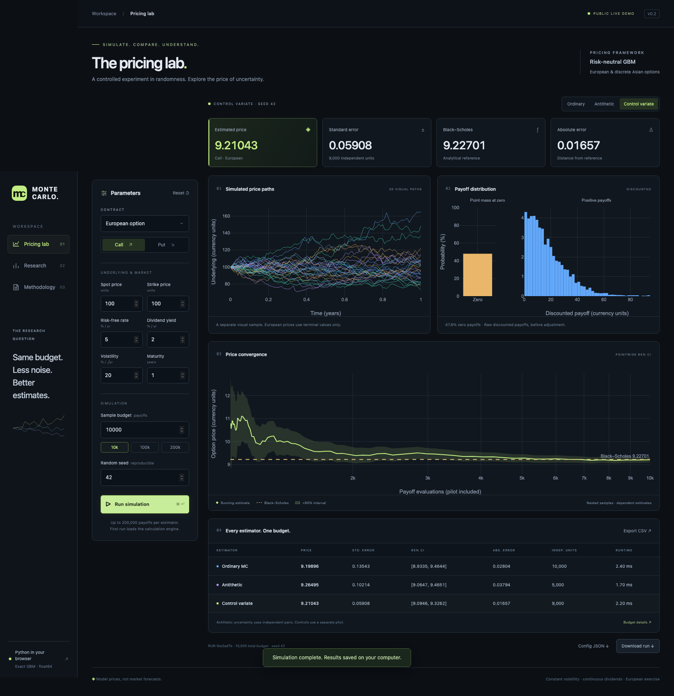

# Monte Carlo Options Lab

**How much pricing noise can you remove without increasing the sample budget?**

A quantitative research project comparing ordinary Monte Carlo, antithetic variates
and an independent-pilot control variate. European options are benchmarked against
Black–Scholes with dividends; a discrete arithmetic Asian extension uses an analytical
geometric-average payoff control.

Python · NumPy · SciPy · pandas · Plotly · TypeScript · [MIT license](LICENSE)



## Results at a glance

The saved European study contains **21,600 estimates**: 24 pricing cases × 3 budgets ×
100 independent seeds × 3 estimators. Every budget includes pilot costs.

| Estimator | Median empirical variance reduction | Mean empirical 95% CI coverage |
| --- | ---: | ---: |
| Ordinary Monte Carlo | 1.00× | 93.90% |
| Antithetic pairs | 1.75× | 94.31% |
| Stock control variate | 3.22× | 93.58% |

These are medians/means across case–budget cells, not guarantees for individual options.
Some cases became worse. Rare payoffs produced substantial undercoverage: an apparently
precise normal interval can miss uncertainty from events that were never sampled.

**The contribution is the comparison and uncertainty analysis—not another way to
compute a European price that already has an analytical formula.**

Read the [measured results](docs/RESULTS.md), [methodology](docs/METHODOLOGY.md) and
[checksummed evidence index](reports/published/publication_index.json).

## Live demo

[Open the public pricing lab](https://mcopricingsim.adeptrhea24.chatgpt.site). First calculation downloads the Python browser runtime. Runs stay in your browser; download a ZIP to keep them. Public budgets are capped at 200,000 payoff evaluations per estimator. See the [publication playbook](docs/DEPLOYMENT_PLAYBOOK.md).

## Run the app

Requires Python 3.12 and [uv](https://docs.astral.sh/uv/). From this repository:

```bash
uv sync --locked --python 3.12
uv run --locked quant-options-app
```

Open `http://127.0.0.1:8501`. Choose assumptions, then press **Run simulation**.
No API keys, market subscriptions or hosted services are required. After dependencies
are installed, the app and routine tests work offline.

The front end is custom HTML/CSS/TypeScript; the Python package performs all numerical
calculations. Plotly's browser bundle is served locally. The compiled JavaScript is
included, so Node is needed only when changing or rebuilding the front end.

If uv is unavailable, bootstrap it inside the project:

```bash
python3 -m venv .bootstrap
.bootstrap/bin/python -m pip install uv==0.13.5
export UV_CACHE_DIR="$PWD/.uv-cache"
export UV_PYTHON_INSTALL_DIR="$PWD/.python"
.bootstrap/bin/uv sync --locked --python 3.12
.bootstrap/bin/uv run --locked quant-options-app
```

## What you can explore

- European calls/puts, dividend-adjusted Black–Scholes and exact deterministic limits.
- Ordinary, antithetic and independent-pilot stock-control estimators.
- Three core charts: separate GBM visual paths, discounted payoff distribution with
  zero-payoff mass, and price convergence with pointwise uncertainty.
- Price, standard error, approximate 95% interval, analytical error, independent-unit
  count, pilot cost and runtime for every estimator.
- Saved research comparisons: RMSE, coverage, variance reduction and error versus time.
- Arithmetic Asian options with explicit observation dates and a geometric payoff control.
- CSV, configuration JSON and complete-run ZIP downloads with numerical arrays and provenance.

Hovering and estimator switches inspect existing samples. Editing inputs flags the
previous results as stale until you explicitly run again. Refresh restores a saved
run without resampling. A failed request retains the last successful result.

## Reproduce the experiments

```bash
uv run --locked quant-options demo
uv run --locked quant-options price --config configs/european.json
uv run --locked quant-options benchmark --config configs/benchmark.json
uv run --locked quant-options asian --config configs/asian.json
```

The European grid crosses calls/puts, strikes 80/100/120, volatilities 15%/40%, and
maturities 0.25/2 years, with spot 100, r=5% and q=2%. Budgets are 1,000/4,000/16,000.
The Asian example uses 12 equally weighted dates, 50 repeats per estimator and an
independent 500,000-budget numerical reference.

Each command prints a unique folder under `reports/experiments/`. To generate a report
and portable evidence from three completed runs, substitute the printed UUIDs:

```bash
uv run --locked python -m mc_options.reporting.publish \
  --pricing reports/experiments/PRICING_RUN_ID \
  --benchmark reports/experiments/BENCHMARK_RUN_ID \
  --asian reports/experiments/ASIAN_RUN_ID
```

Selected real results are already included in `reports/published/`; each seed is
retained in the repeated-run Parquet table. Large raw/generated runs stay ignored.
The [RMSE](reports/figures/rmse.html) and [error/time](reports/figures/error_time.html)
HTML figures can be downloaded and opened locally; GitHub does not execute them inline.

## Mathematical choices

European terminal prices are sampled directly:

```text
S_T = S0 × exp((r − q − sigma²/2)T + sigma × sqrt(T) × Z),  Z ~ N(0, 1)
Y   = exp(−rT) × option payoff
```

Rates and dividend yield are continuously compounded annual fractions. Volatility is
annualised; maturity and Asian observation dates are supplied in years. Currency units
are arbitrary but consistent between spot, strike, payoff and price.

The requested N is a **total payoff-evaluation budget**:

| Estimator | Independent sampling unit | Budget convention |
| --- | --- | --- |
| Ordinary | One discounted payoff | N independent draws |
| Antithetic | Mean of positive/negative-shock payoffs | floor(N/2) independent pairs |
| Control | Adjusted production payoff | N minus an independent pilot |

The pilot uses max(32, floor(N/10)) draws to fit the coefficient. For the stock control,
X=exp(−rT)S_T has known expectation S0 exp(−qT). Standard errors use independent
production units; antithetic errors use pair averages rather than correlated legs.

Confidence intervals are asymptotic normal approximations. Nested convergence points
are dependent; their bands are pointwise. Rare-event diagnostics and repeated-run
coverage expose situations in which these intervals are unreliable.

The Asian geometric price is a **control expectation**, not the arithmetic price.
The arithmetic reference is independently sampled and includes its own uncertainty.
See [METHODOLOGY.md](docs/METHODOLOGY.md) for derivations and the rare-payoff failure
that shaped the validation design.

## Validation and development

The checked local build has **54 passing Python tests**, also passed from an extracted
source archive. See the [release validation record](docs/VALIDATION.md). They cover references, parity,
limits, seed reproducibility, manual uncertainty formulas, repeated-run convergence,
invalid inputs, Asian controls, HTTP workflows and downloadable artifact hashes.

```bash
uv run --locked pytest -q
uv run --locked ruff check .
uv run --locked ruff format --check .
uv lock --check
```

To edit the front end (Node 24 was used):

```bash
npm ci --ignore-scripts --cache .npm-cache
npm run typecheck
npm run build
```

For a browser check, start the app in another terminal, then:

```bash
export PLAYWRIGHT_BROWSERS_PATH="$PWD/.browsers"
uv run --locked playwright install chromium
uv run --locked python tests/browser_smoke.py
```

The browser workflow checks explicit runs, hover/switch stability, input changes,
restoration, downloads, research navigation, invalid inputs, Asian options and three
screen sizes. GitHub Actions is configured for locked installation, TypeScript checks,
Python lint/format/tests and a CLI smoke run; remote execution is verified separately.

## Project structure

```text
src/mc_options/
  models/        analytical references, sampling, payoffs, estimators, Asian extension
  evaluation/    repeated-seed benchmarks, coverage and convergence
  reporting/     charts, manifests and portable research reports
  web.py         local HTTP application and API
app/web/         HTML/CSS, TypeScript source and compiled browser bundle
configs/         European, benchmark-grid and Asian experiment configurations
tests/           numerical, integration and opt-in browser checks
reports/         published evidence, figures and ignored generated experiments
docs/            methodology, results, reproducibility and publication materials
```

Every run records configuration, seeds, UTC timestamps, code/dependency hashes,
checksummed artifacts and Git state when available. Historical manifests preserve the
versions actually used for their experiments. They record unavailable Git metadata as
null with an explanation rather than inventing a commit.

## Scope and limitations

Prices are conditional on constant-parameter risk-neutral GBM. They are **not forecasts
of realised market returns**. There is no market calibration, volatility smile, jumps,
early exercise, trading strategy or brokerage integration. European analytical pricing
is the benchmark; the simulation is used to study estimators.

Timings come from one uncontrolled host, and results depend on the synthetic grid.
The app binds to loopback for local research use. Public multi-user hosting is outside
this release. See [CONTRIBUTING.md](CONTRIBUTING.md) for development conventions and
[DATA.md](docs/DATA.md) for artifact provenance.

## License

Original project code is released under the [MIT license](LICENSE). Dependencies
retain their own licenses; see [THIRD_PARTY_NOTICES.md](THIRD_PARTY_NOTICES.md).
